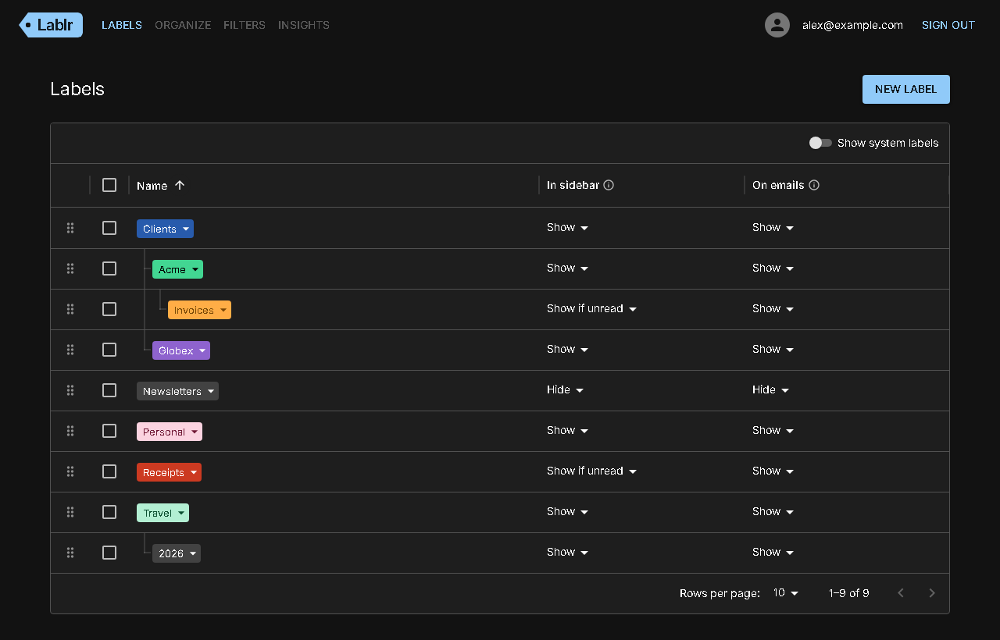
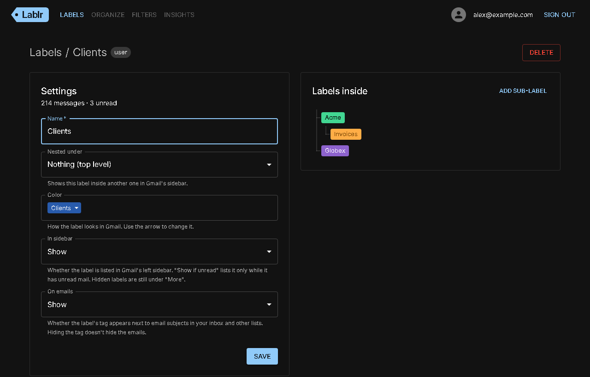
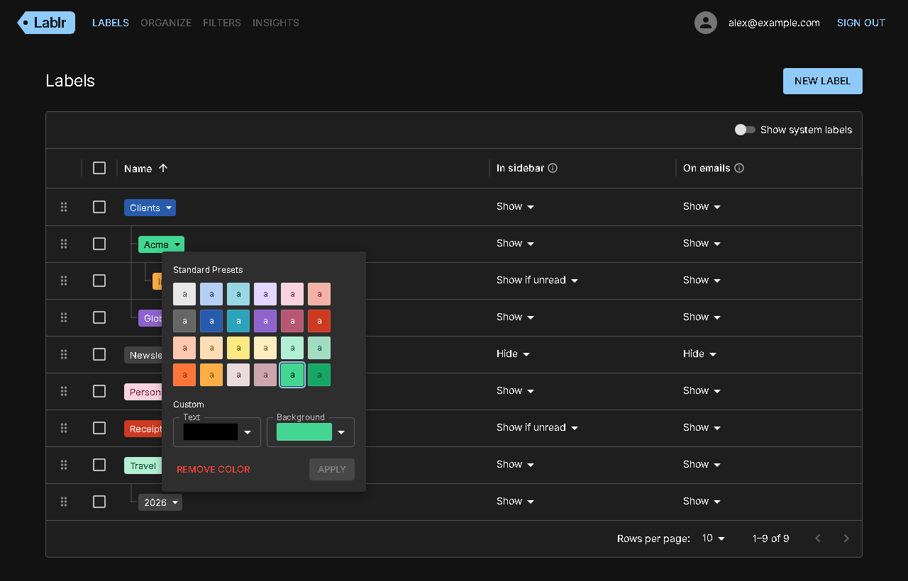
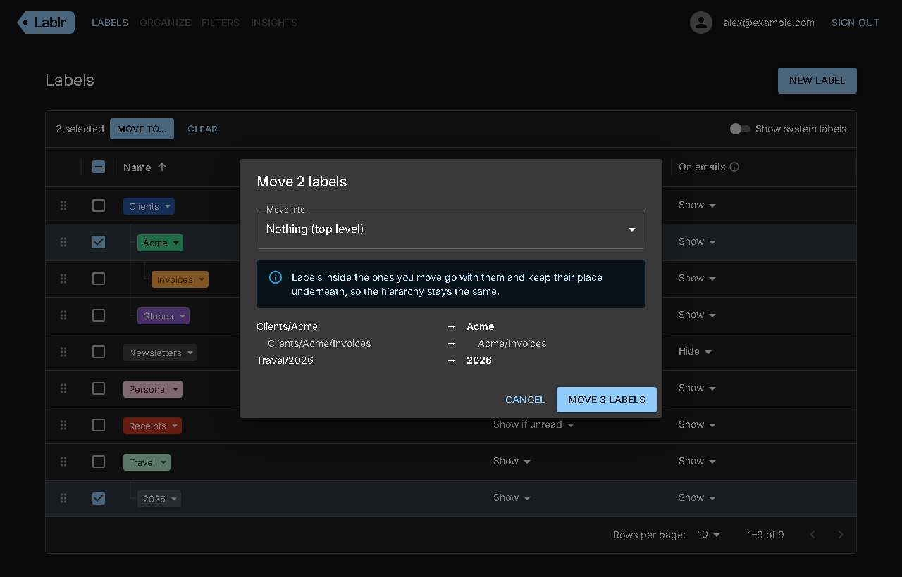

# Lablr

Manage your Gmail labels: list them in a Data Grid, create, rename, nest, color and delete them. A Spring Boot API sits between the React app and the Gmail API, signing users in with Google and only asking for the `gmail.labels` scope.

## Screenshots

With sample labels.









## Layout

| Path                 | What                                                    |
|----------------------|---------------------------------------------------------|
| `frontend/`          | React Router (TypeScript, Vite) SPA                     |
| `backend/`           | Java 25 Spring Boot (Maven) REST API, port 8080         |
| `Dockerfile`         | One image: the backend serving the built frontend       |
| `docker-compose.yml` | Runs that image locally                                 |

The browser only ever talks to one origin. In development Vite proxies `/api/*`, `/oauth2/*`, `/login/oauth2/*` and `/logout` to the backend. In Docker and on Cloud Run there's one image, where Spring Boot serves the built frontend itself. Either way the session cookie is first-party and there's no CORS.

## API

All endpoints need a signed-in session. Errors are [problem details](https://www.rfc-editor.org/rfc/rfc9457), and every response has an `X-Request-Id` that matches the backend's log lines.

| Method   | Path                                  | Does                                                           |
|----------|---------------------------------------|----------------------------------------------------------------|
| `GET`    | `/api/me`                             | Signed-in user                                                 |
| `GET`    | `/api/labels`                         | List labels                                                    |
| `GET`    | `/api/labels/{id}`                    | Get a label, with message counts                               |
| `POST`   | `/api/labels`                         | Create a label                                                 |
| `PATCH`  | `/api/labels/{id}`                    | Update a label. Renaming also moves its nested labels          |
| `DELETE` | `/api/labels/{id}/color`              | Remove a label's color                                         |
| `DELETE` | `/api/labels/{id}?deleteNested=false` | Delete a label. Nested labels move up a level unless `true`    |

Gmail doesn't move nested labels itself, so the backend does, and rolls back if a step fails.

## Google OAuth setup

Copy `.env.example` to `.env` and fill in a Google OAuth client ID and secret (Web application, `gmail.labels` scope). Add `http://localhost:3000/login/oauth2/code/google` as a redirect URI. The app is on port 3000 whether it runs directly or under Docker.

While the OAuth consent screen is in testing, only accounts listed as test users can sign in, so add yours there.

## Run everything with Docker

```bash
docker compose up --build
```

- App: http://localhost:3000
- Health: http://localhost:3000/actuator/health

## Run each part directly

Start both, then open http://localhost:3000. Stop the Docker stack first, since it uses the same ports.

### Backend (requires JDK 25+)
```bash
cd backend
./mvnw spring-boot:run      # Windows: mvnw.cmd spring-boot:run
./mvnw test
```

Set `LOGGING_LEVEL_COM_LABLR_BACKEND_LABEL=DEBUG` to log every step of nested renames, moves and deletes.

### Frontend
```bash
cd frontend
npm install
npm run dev
npm test                    # unit tests (Vitest)
npm run lint                # ESLint
```

## Hosting on Cloud Run

The root `Dockerfile` is all Cloud Run needs. One-time setup, with the [gcloud CLI](https://cloud.google.com/sdk/docs/install):

```bash
gcloud config set project YOUR_PROJECT_ID
gcloud services enable run.googleapis.com cloudbuild.googleapis.com artifactregistry.googleapis.com secretmanager.googleapis.com

printf '%s' 'YOUR_CLIENT_ID' | gcloud secrets create google-client-id --data-file=-
printf '%s' 'YOUR_CLIENT_SECRET' | gcloud secrets create google-client-secret --data-file=-
for s in google-client-id google-client-secret; do
  gcloud secrets add-iam-policy-binding $s \
    --member=serviceAccount:YOUR_PROJECT_NUMBER-compute@developer.gserviceaccount.com \
    --role=roles/secretmanager.secretAccessor
done
```

Then deploy (and redeploy) with `./deploy.sh`. It prints the service URL. Add `https://<that URL>/login/oauth2/code/google` as a redirect URI on the OAuth client, and either publish the consent screen or add whoever needs access as a test user.
